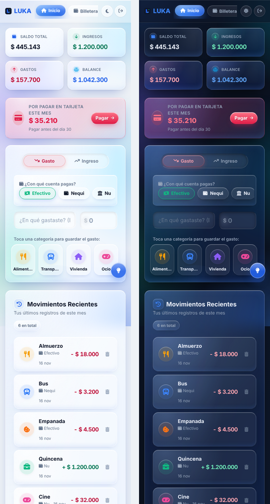
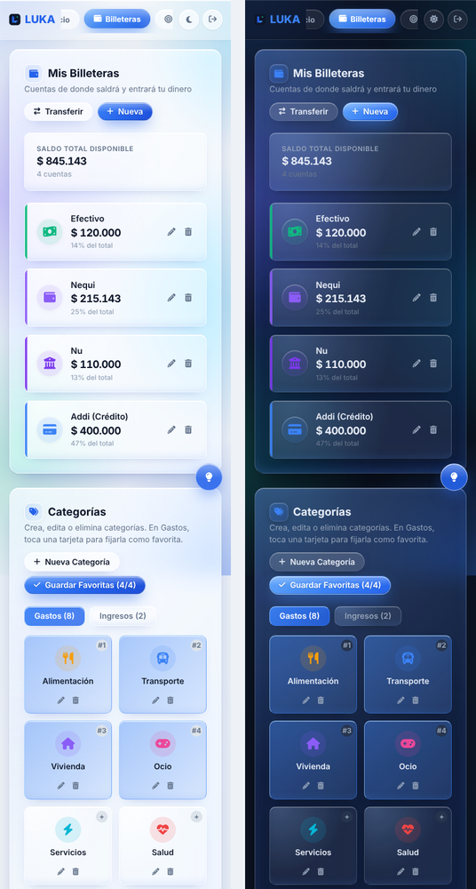
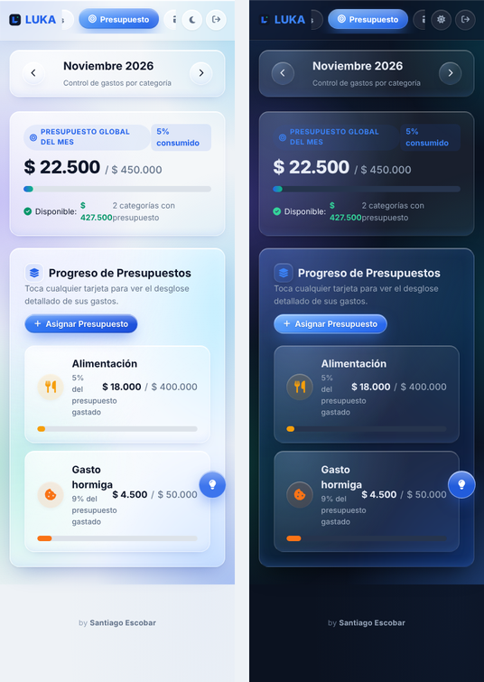
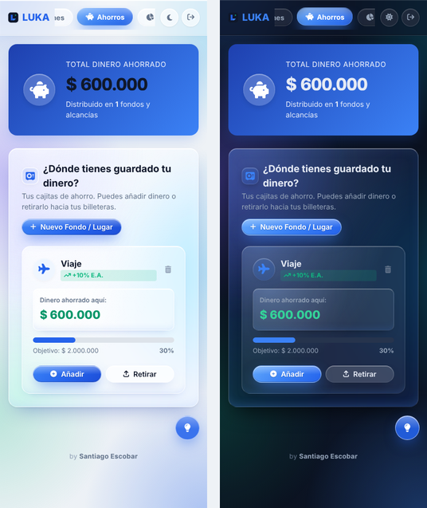

# LUKA

Aplicación web de finanzas personales: registro de gastos e ingresos, cuentas, presupuestos por categoría, tarjetas de crédito, suscripciones y fondos de ahorro. Está hecha con SvelteKit, se prerenderiza como sitio estático, usa Supabase para la base de datos y la autenticación, se despliega en Vercel y se puede instalar como app (PWA).

> **Código visible, no abierto.** Se puede leer y evaluar, pero no copiar ni reutilizar: ver [LICENSE](LICENSE).

---

## Vista previa

Modo claro y oscuro, con datos de demostración.

<p align="center"></p>

<details>
<summary>Billeteras, presupuestos y ahorros</summary>

<p align="center">
  
  
  
</p>

</details>

## Qué demuestra este proyecto

* **Datos y seguridad:** aislamiento por usuario con RLS en PostgreSQL, funciones RPC atómicas para saldos, un trigger que impide tocar billeteras ajenas y permisos de funciones revisados con los avisos de seguridad de Supabase.
* **SvelteKit prerenderizado:** cada pestaña es una ruta real (enlace directo y botón Atrás), cada vista se carga bajo demanda y todo sale como HTML estático en la CDN de Vercel, sin servidor.
* **Experiencia móvil:** PWA instalable, navegación por gestos, esqueletos de carga, tema claro/oscuro animado y desbloqueo con Face ID o huella (WebAuthn).
* **Pruebas de la lógica financiera:** el cálculo de cuotas, saldos y fechas de préstamos tiene pruebas automáticas que corren en cada PR.
* **Rendimiento medido:** el cambio de tema y el desplazamiento se midieron con la CPU limitada 6× y se ajustaron hasta mantener unos 50 a 60 fps.
* **Accesibilidad y preferencias del sistema:** respeta `prefers-reduced-motion` y `prefers-reduced-transparency`, y el deslizador de ingreso funciona también con teclado.

---

## 1. Qué resuelve

* Registrar un gasto con un solo toque, sin pantallas intermedias.
* Ver el saldo de cada cuenta (efectivo, bancos, billeteras digitales) en un solo lugar.
* Saber qué pagos fijos del mes ya se hicieron.
* Separar el dinero de uso diario del dinero ahorrado.
* Entender cuánto se debe en tarjetas, con cuotas, intereses y fecha de pago.

## 2. Decisiones de diseño

* **SvelteKit con migración gradual:** el marco (cabecera, navegación, pie, páginas legales) y el Conversor ya son componentes Svelte; las demás vistas conservan su render original y se montan con `LegacyView.svelte` hasta pasarlas una a una.
* **Sin código de terceros en tiempo de ejecución:** `supabase-js` y los iconos se instalan con npm y se empaquetan; no se carga nada desde CDNs.
* **Aislamiento entre usuarios con RLS:** cada fila tiene `user_id` y las políticas limitan el acceso a `auth.uid() = user_id` (ver `supabase/schema.sql`).
* **Saldos coherentes:** el trigger `tr_transaction_balance` ajusta el saldo de la billetera al crear o borrar una transacción, por lo que el código no lo toca a mano en esos casos. Para el cupo de las tarjetas y las transferencias, `walletService.adjustBalance()` usa funciones RPC atómicas (`supabase/schema.sql`); si no están desplegadas, lee y escribe.
* **Móvil primero:** pestañas deslizables, montos con separador de miles (`es-CO`) y tutorial en el primer ingreso.
* **Tema claro y oscuro:** los colores salen de variables CSS en `src/lib/styles/main.css`; el tema oscuro solo las redefine.

---

## 3. Módulos del Sistema

### 3.1. Inicio y Registro Rápido
* Métricas del mes: ingresos, gastos y balance neto.
* Barra de registro rápido: elegir cuenta, escribir el monto y tocar una de las 4 categorías favoritas.
* Selector modal para categorías secundarias.
* Movimientos recientes (últimos 5, con opción de ver todos) y eliminación de transacciones.
* Banner con el total estimado a pagar de las tarjetas de crédito y su fecha límite más cercana.

### 3.2. Billeteras
* Múltiples cuentas (efectivo, bancos, billeteras digitales) con icono y color propios.
* Ajuste manual de saldo para conciliar diferencias con la realidad.
* **Transferencias entre cuentas** que no afectan los ingresos ni los gastos del mes.
* Gestión de categorías: crear, editar, eliminar y fijar hasta 4 favoritas para el registro rápido. Una categoría con movimientos asociados no puede eliminarse (solo editarse).

### 3.3. Presupuestos
* Límite mensual por categoría de gasto.
* Cruce automático con las transacciones reales del mes: gastado, restante, porcentaje de uso y aviso de presupuesto excedido.
* Resumen global (total presupuestado vs. total gastado) y detalle de las transacciones de cada categoría.

### 3.4. Crédito: Tarjetas y Préstamos
La pestaña **Crédito** tiene dos secciones, porque funcionan distinto.

**Tarjetas**
* Cada tarjeta crea una billetera vinculada que representa el **cupo disponible**.
* Registro de **compras a cuotas** y **avances en efectivo** (con comisión y cuenta de destino), con opción de compra a 0 % de interés.
* **Proyección del extracto** del próximo corte: capital de cuotas, intereses (tasa E.A. convertida a mensual), cuota de manejo y fecha límite de pago.
* Pago de tarjeta desde una cuenta de débito: libera cupo, avanza las cuotas pagadas y registra el gasto.
* Eliminar una compra restaura el cupo disponible.

**Préstamos** (apps de crédito como Addi, bancos o deudas con personas)
* Cada préstamo guarda quién prestó (app, persona o banco), el monto, y opcionalmente cuotas fijas con interés E.A. (cuota calculada con el sistema francés) o pago libre, más una fecha de primer pago o límite.
* Se ve el saldo pendiente, el avance, la próxima cuota y si está vencida; arriba, el total que debes y el próximo pago.
* **Registrar pago** descuenta de la cuenta elegida y queda como gasto ("Pago préstamo: …"); borrar un pago devuelve el dinero a la cuenta.
* Al crear el préstamo se puede sumar el dinero a una cuenta, sin contarlo como ingreso.
* Usa las tablas `loans` y `loan_payments` (con RLS por usuario); si aún no existen, la sección lo avisa.

### 3.5. Suscripciones y Pagos Fijos
* Pagos recurrentes asociados a un día de cobro, billetera y categoría.
* Estado dinámico *Pendiente* / *Pagada* calculado a partir de las transacciones del mes en curso; se reinicia solo cada mes calendario, sin tareas programadas en el servidor.
* Confirmar un pago con un clic genera el gasto y descuenta el saldo de la cuenta elegida.
* Pausar, reanudar o eliminar suscripciones.

### 3.6. Ahorros (Cajitas y Metas)
* Fondos con meta (monto objetivo y fecha opcional) o sin ella.
* **Rendimiento opcional** por tasa efectiva anual: los intereses se liquidan por días completos transcurridos con interés compuesto cada vez que se consultan los fondos.
* Aportes que descuentan de la billetera elegida (se registran como gasto de ahorro) y retiros que regresan el dinero a una billetera (se registran como ingreso).
* Barra de progreso hacia la meta.

### 3.7. Análisis
* **Consolidado mensual:** ingresos, egresos y balance neto.
* **Gasto por categoría:** distribución porcentual y monto acumulado, con la categoría de mayor impacto.
* **Consolidado anual:** comparativa mes a mes de ingresos vs. egresos.
* Navegación entre meses y años.

### 3.8. Conversor y monedas
* Cada billetera tiene su moneda (COP, USD o EUR), elegida al crearla.
* Los totales de Inicio y Billeteras se muestran en la moneda base de la cuenta, convirtiendo cada billetera con la tasa del día.
* Pestaña Conversor: convierte entre las tres monedas, muestra las tasas y permite cambiar la moneda base.
* Las tasas vienen de open.er-api.com, se guardan 6 horas en el dispositivo y, sin conexión, se usan tasas aproximadas.
* Límites: presupuestos y análisis aún suman los montos sin convertir, y solo se transfiere entre cuentas de la misma moneda.

### 3.9. Tutorial interactivo
* Pantalla de apertura animada (logo, "LUKA" y lema) una vez por sesión; un toque la salta y se omite con "reducir movimiento" (`src/lib/styles/splash.css`, `src/lib/ui/Splash.svelte`).
* Guía paso a paso por cada pestaña (Inicio, Billeteras, Presupuesto, Crédito, Suscripciones, Ahorros y Análisis), disponible desde un botón flotante.

### 3.10. Acceso y bloqueo con Face ID
* Ingreso con celular, correo o Google, con un deslizador «desliza para ingresar».
* **Face ID / huella (opcional):** tras iniciar sesión se ofrece activar el desbloqueo biométrico (WebAuthn con autenticador de la plataforma, `src/lib/services/biometricService.js`). Con él activo, la app pide la verificación al abrirse y al volver tras más de un minuto en segundo plano. Es un candado local sobre la sesión ya guardada: no inicia sesión por sí solo ni guarda datos biométricos. Cerrar sesión lo desactiva.
* Cada celular puede vincularse a un máximo de 2 cuentas.

### 3.10. Modo oscuro y estilo visual
* Botón de luna/sol en el header (visible también en la pantalla de acceso).
* Orden de prioridad: preferencia guardada por el usuario (`localStorage`, clave `luka_theme`) > preferencia del sistema (`prefers-color-scheme`).
* Un pequeño script en `<head>` aplica el tema antes de pintar, evitando el parpadeo blanco al cargar.
* Si el usuario nunca eligió manualmente, la app sigue los cambios del sistema en tiempo real.
* Actualiza el `theme-color` del navegador móvil y usa `color-scheme` para que los controles nativos (fechas, selects, scrollbars) también se vean oscuros.
* El cambio de tema se anima desde el botón (View Transitions API, con respaldo por fundido).
* Estilo «liquid glass» (`src/lib/styles/glass.css`, `src/lib/styles/liquid.css`): superficies translúcidas con desenfoque y borde de luz, y esqueletos de carga al cambiar de pestaña. Respeta `prefers-reduced-motion` y `prefers-reduced-transparency`.

---

## 4. Arquitectura de Software y Stack Tecnológico

### Capa Cliente
* **Framework:** SvelteKit 3 (Svelte 5 con runas) sobre Vite 8, en JavaScript.
* **Rutas:** `/`, `/billeteras`, `/presupuesto`, `/credito`, `/suscripciones`, `/ahorros`, `/analisis`, `/conversor`, `/privacidad` y `/terminos`. Todas se prerenderizan.
* **Organización:** servicios de datos (`src/lib/services`), componentes heredados (`src/lib/components`), vistas heredadas (`src/lib/views`), componentes Svelte (`src/lib/ui`) y controlador de sesión (`src/lib/appController.js`).
* **Dependencias:** `@supabase/supabase-js`, Phosphor Icons y Font Awesome 6, todas desde npm.

### Capa de Datos (Backend as a Service)
* **Plataforma:** Supabase.
* **Base de datos:** PostgreSQL con Row Level Security.
* **Autenticación:** Supabase Auth con JWT: correo y contraseña, celular (correo interno `@phone.luka.app`) y Google.

### Infraestructura
* **Despliegue:** Vercel con `@sveltejs/adapter-vercel`; cabeceras de seguridad en `vercel.json`.
* **PWA:** `static/manifest.webmanifest` y `src/service-worker.js` (archivos con hash en caché permanente; páginas con red primero y copia sin conexión; Supabase nunca pasa por caché).
* **Control de versiones:** Git / GitHub.

---

## 5. Estructura del Directorio

```text
├── CHANGELOG.md                    # Cambios por versión (Keep a Changelog)
├── CONTRIBUTING.md                 # Ramas, commits y versiones
├── LICENSE                         # Licencia de código visible
├── docs/                           # Capturas, manual de identidad y nota sobre el historial
├── vite.config.js                  # SvelteKit, adaptador de Vercel y política de seguridad de contenido (CSP)
├── vercel.json                     # Cabeceras de seguridad (HSTS, frame-ancestors, Permissions-Policy…)
├── .env.example                    # Variables públicas de Supabase
├── supabase/                       # schema.sql y migraciones
├── tests/                          # Pruebas de préstamos y monedas (node:test)
├── static/                         # favicon, iconos, manifest y boot.js (tema antes de pintar)
└── src/
    ├── app.html                    # Plantilla HTML
    ├── env.js                      # Declaración y validación de variables de entorno
    ├── service-worker.js           # Caché offline de la PWA
    ├── routes/
    │   ├── +layout.svelte          # Cabecera, navegación, pie con enlaces legales
    │   ├── (app)/                  # Pestañas de la app (con sesión)
    │   │   ├── +layout.svelte      # Login / vincular celular / app, y dirección de la transición
    │   │   └── conversor/          # Primera vista nativa en Svelte
    │   ├── privacidad/             # Política de privacidad
    │   └── terminos/               # Términos, licencia y copyright
    └── lib/
        ├── appController.js        # Sesión, Face ID, notificaciones, tutorial y gestos (antes main.js)
        ├── session.svelte.js       # Estado compartido de la sesión
        ├── tabs.js · views.js      # Pestañas y carga diferida de vistas
        ├── legal.js                # Autor, contacto y fecha de los textos legales
        ├── ui/                     # Componentes Svelte (LegacyView, Tab, Splash, Footer, LegalPage)
        ├── styles/                 # CSS liquid glass (main, components, views, glass, splash, liquid, app)
        ├── services/               # Acceso a Supabase y lógica financiera
        ├── components/             # Componentes heredados (barra rápida, tutorial, Face ID…)
        └── views/                  # Vistas heredadas, pendientes de migrar a Svelte
```

> **Nota:** los nombres de archivo distinguen mayúsculas y minúsculas en Linux/Vercel. Todos los módulos usan `camelCase` y los imports deben coincidir exactamente.

---

## 6. Modelo de Datos

Las tablas, políticas RLS, índices, funciones y triggers están en `supabase/schema.sql`:

| Tabla | Propósito |
|---|---|
| `wallets` | Cuentas y billeteras con su saldo; también representa el cupo disponible de cada tarjeta |
| `categories` | Categorías de gasto o ingreso, con favoritas ordenadas |
| `transactions` | Ingresos y gastos asociados a una billetera y una categoría |
| `budgets` | Límite mensual por categoría (único por `user_id` + `category_id`) |
| `credit_cards` | Datos de la tarjeta: cupo, tasa E.A., día de corte, día de pago y cuota de manejo |
| `credit_card_purchases` | Compras y avances con número de cuotas, cuotas pagadas y comisión |
| `subscriptions` | Pagos recurrentes con día de cobro y estado activo |
| `saving_goals` | Fondos de ahorro con meta, monto actual, tasa de rendimiento y fecha de última liquidación |
| `loans` | Préstamos (de app, persona o banco) con monto, interés, cuotas y primera fecha de pago |
| `loan_payments` | Pagos de cada préstamo, enlazados a su gasto |
| `profiles` | Datos básicos del usuario, creados al registrarse |
| `user_phones` | Celular vinculado (máximo 2 cuentas por número) |
| `user_activity` | Última actividad, para limpiar cuentas inactivas |

Todas las tablas tienen RLS activado, con una política que limita cada fila a su dueño (`auth.uid()`).

---

## 7. Instalación y Ejecución Local

Requiere Node 22.17 o superior.

1. Clona el repositorio e instala dependencias:
   ```bash
   git clone https://github.com/S3scobar/luka-finanzas.git
   cd luka-finanzas
   npm install
   ```
2. Crea tu propio proyecto en [Supabase](https://supabase.com) y ejecuta `supabase/schema.sql` en el SQL Editor.
3. Copia `.env.example` a `.env` y pon la URL y la **anon key** de tu proyecto (nunca la `service_role`).
4. `npm run dev` y abre `http://localhost:5173`.

### Despliegue en Vercel
Vercel detecta SvelteKit solo. En **Settings → Environment Variables** define `PUBLIC_SUPABASE_URL` y `PUBLIC_SUPABASE_ANON_KEY`: si faltan, el build falla a propósito. En Supabase, agrega la URL de Vercel a **Authentication → URL Configuration** para el inicio con Google.

---

### Pruebas

```bash
npm test        # lógica de préstamos y monedas (node:test, sin red)
npm run check   # componentes Svelte
npm run build   # build completo con prerenderizado
```

`tests/helpers/` sustituye `supabase-js` y las variables de entorno para cargar los servicios sin red. GitHub Actions corre las tres cosas en cada push y PR.

## 8. Varios usuarios a la vez

* **Datos:** cada usuario solo ve sus filas gracias a RLS. `supabase/schema.sql` define las políticas de todas las tablas y los índices por `user_id` que las respaldan.
* **Saldos:** dos pestañas o dispositivos del mismo usuario pueden modificar una cuenta a la vez. Con las funciones de `supabase/schema.sql` desplegadas, el ajuste es una sola sentencia SQL y no se pierde ninguna actualización.
* **Sesión compartida entre pestañas:** `supabase-js` guarda la sesión en `localStorage`. Si en otra pestaña se cierra sesión o entra otro usuario, esta pestaña vuelve al login o recarga los datos del usuario nuevo; no sigue mostrando los del anterior.
* **Estado en pantalla:** al cambiar de usuario se reinician los filtros de mes, la tarjeta seleccionada y la pestaña activa.
* **Respuestas tardías:** cada pestaña se pinta en su propio contenedor, así una consulta lenta no sobrescribe la pestaña que el usuario abrió después.
* **Volumen:** las consultas de movimientos se piden por páginas de 1000 filas (el máximo de Supabase por petición).

## 9. Seguridad y limitaciones

* **Clave pública:** la `anon key` es pública por diseño (va en el bundle); la protección depende de las políticas RLS. Ya no está en el repositorio: se configura como variable de entorno.
* **Cabeceras y CSP:** `script-src 'self'` con hashes (sin scripts en línea ni CDNs), `connect-src` limitado a Supabase y a la API de tasas, `frame-ancestors 'none'`, HSTS y `Permissions-Policy`. `style-src` aún permite `'unsafe-inline'` porque las vistas heredadas usan atributos `style`; Trusted Types queda para cuando esas vistas dejen de usar `innerHTML`.
* **Textos legales:** `/privacidad` (Ley 1581 de 2012) y `/terminos` (licencia de código visible, copyright y marca), enlazados desde el pie de página.
* **Fondos de ahorro:** aportes y retiros siguen leyendo y escribiendo `saving_goals.current_amount` en pasos separados; falta una función RPC como la de las billeteras.
* **Compras con tarjeta:** registrar una compra implica varias llamadas (compra, cupo, transacción). Si una falla a mitad, los datos pueden quedar a medias. Lo ideal es una función SQL que haga todo en una transacción.
* **Pagos de tarjeta y avances anteriores:** hasta esta versión `payCard()` y el avance de `addPurchase()` ajustaban el saldo a mano y además el trigger lo ajustaba al registrar la transacción, así que el movimiento se contaba dos veces. Ya no ocurre, pero los saldos de pagos y avances hechos antes pueden estar desviados: corrígelos con el lápiz de editar en Billeteras.
* **Funciones de base de datos:** las de uso interno (disparadores y la limpieza de inactivos) no son ejecutables desde la API pública; el disparador de saldo comprueba que la billetera pertenezca al usuario. Las políticas RLS aplican solo al rol `authenticated`.
* **Limpieza de inactivos:** `purge_inactive_users()` elimina las cuentas sin actividad en 2 meses (tarea diaria con `pg_cron`).
* **Face ID:** es un candado local; no sustituye la contraseña ni protege la cuenta desde otro dispositivo.
* **Correo sin verificar:** el trigger `auto_confirm_user` confirma cualquier correo al registrarse, por lo que nadie comprueba que el correo sea real. Es cómodo, pero no comprueba que el correo pertenezca a quien se registra.
* **Pago de suscripciones y tarjetas:** se detecta por el texto del título del movimiento («Pago: nombre», «Pago Tarjeta: nombre»). Si el usuario edita ese texto, el estado cambia.
* **Escape de HTML:** el texto escrito por el usuario pasa por `escapeHtml()` antes de entrar a una plantilla. Al agregar vistas nuevas, haz lo mismo.
* **Accesibilidad:** el `viewport` bloquea el zoom (`user-scalable=no`).
* **Versión de `supabase-js`:** se carga `@2` sin fijar versión; conviene fijar una versión exacta.

---

## 10. Pendiente

- [ ] Mover aportes de ahorro y compras con tarjeta a funciones RPC.
- [ ] Fijar la versión de `supabase-js`.
- [x] PWA instalable.
- [x] Desbloqueo con Face ID / huella.
- [ ] Contraseñas filtradas: activar «Leaked password protection» en Supabase Auth.
- [ ] Calcular totales en la base de datos en lugar del navegador.
- [ ] Exportar movimientos a CSV.

---

## 11. Ciclo de desarrollo y control de versiones

El proyecto se construyó en iteraciones cortas, cada una con su versión, su etiqueta y su entrada en el [CHANGELOG](CHANGELOG.md).

| Versión | Fecha | Iteración |
|---|---|---|
| 1.0.0 | 31 oct | Primera versión: billeteras, gastos, presupuestos, tarjetas, suscripciones, ahorros y análisis |
| 1.1.0 | 1 nov | Base multiusuario y tutorial con Presupuesto |
| 1.2.0 | 3 nov | Iconos, deslizador de ingreso y navegación por gestos |
| 2.0.0 | 6 nov | Rediseño liquid glass, tema animado y pestaña Crédito con préstamos |
| 2.1.0 | 14 nov | App instalable (PWA), pantalla de apertura y liquid glass v2 |
| 2.2.0 | 15 nov | Google, Face ID, base de datos endurecida, CI y primeras pruebas |
| 2.3.0 | 16 nov | Notificaciones y tema oscuro Tinta |
| 2.4.0 | 21 nov | Conversor y moneda por billetera |
| 3.0.0 | 23 nov | Migración a SvelteKit 3 |
| 3.1.0 | 23 nov | Todas las vistas en Svelte, perfil y panel de escritorio |
| 3.2.0 | 23 nov | Manual de marca, auditoría de color y Supabase detrás del dominio |
| 3.3.0 | 25 nov | Pulido móvil y escritorio, atajos personalizados |
| 3.4.0 | 27 nov | Borrar deslizando y categorías de deuda |
| 3.4.1 | 27 nov | Hotfix: la hoja de pago de tarjetas rompía Crédito |
| 3.4.2 | 27 nov | Licencia de código visible, flujo de trabajo y plantillas |

**Flujo de ramas:** Git Flow con `main` (solo versiones etiquetadas), `develop`, `feature/*`, `bugfix/*`, `release/*` y `hotfix/*`, fusionadas con `--no-ff`. **Commits:** Conventional Commits atómicos. **Versiones:** SemVer, con la etiqueta como fuente de verdad. Todo está en [CONTRIBUTING.md](CONTRIBUTING.md); cómo se reconstruyó el historial, en [docs/HISTORIAL.md](docs/HISTORIAL.md).

```bash
git log --graph --oneline --decorate --first-parent develop
git tag -n1
```

## 12. Marca

El [manual de identidad](docs/brand/LUKA-Manual-de-Identidad.pdf) recoge el logotipo, la paleta, la tipografía, la forma y el material, los iconos y la voz de LUKA, y termina con una auditoría que se aplicó en la versión 3.2.0.

---

## Autor

Desarrollado por **Santiago Escobar**.

---

## 13. Licencia

Código visible, todos los derechos reservados. Ver [LICENSE](LICENSE).
